# Protocole Alarme

🇫🇷 [Français](#français) · 🇬🇧 [English](#english)

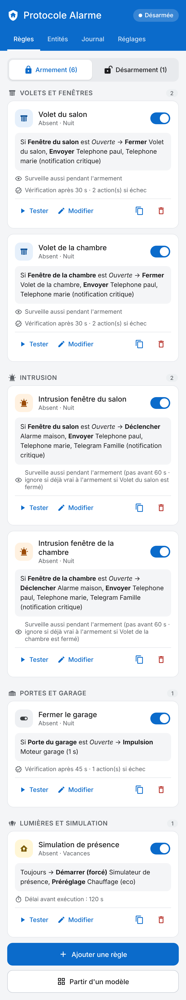

## Français

Protocole Alarme lance des actions quand vous **armez** ou **désarmez** votre alarme Home Assistant. Vous choisissez entité par entité ce qui doit se passer, sans écrire d'automatisation :

- si une fenêtre est ouverte, fermer le volet de la pièce ;
- si la porte du garage est ouverte, envoyer une impulsion au moteur, puis vérifier qu'elle s'est bien fermée ;
- allumer une lumière, passer le chauffage en éco, démarrer le simulateur de présence ;
- au désarmement, arrêter le simulateur, allumer l'entrée, envoyer une notification…

### Fonctionnalités

- **Assistant en 3 étapes** : *Quand* (armement ou désarmement, modes d'alarme), *Si* (conditions facultatives sur l'état d'entités), *Alors* (actions), puis un récapitulatif lisible.
- **Actions paramétrables selon le type d'entité** : volets (ouvrir, fermer, position), lumières (allumer avec luminosité, éteindre), interrupteurs (allumer, éteindre, **impulsion** de durée réglable), serrures, chauffage (préréglage, température), médias, scènes, scripts, automatisations, listes, vannes, boutons et notifications.
- **Vérification du résultat** : après un délai, contrôle qu'une entité est dans l'état attendu (ex. garage fermé) ; sinon notification à **une ou plusieurs personnes** et capteur « Échec de vérification ». Pas de nouvel essai automatique.
- **Notifications vers plusieurs destinataires** : une même action peut prévenir plusieurs téléphones (et/ou Home Assistant).
- **Message d'échec modifiable** : le message par défaut est affiché et peut être personnalisé avec les variables `{{ regle }}`, `{{ entite }}`, `{{ etat_actuel }}`, `{{ etat_attendu }}`, avec un aperçu ; les états reprennent les libellés de Home Assistant.
- **Personnes autorisées** : en plus des administrateurs, d'autres utilisateurs peuvent être autorisés à modifier les règles (onglet Réglages).
- **Choix d'entité lisible** : recherche, filtres par type, et pour chaque entité son type (Fenêtre, Porte de garage, Mouvement…), son état et son icône.
- **Délai avant exécution** par règle.
- **Annulation** : désarmer l'alarme interrompt les règles d'armement encore en cours (délai, impulsion, vérification), et inversement.
- **Redémarrage de Home Assistant** : ne déclenche aucune règle.
- **Simulateur de présence** : pilote [Lights Simulator](https://github.com/akoonet-homeassistant/lights_simulator) (Démarrer, Repasser en Auto, Arrêter). S'il n'est pas installé, le panneau propose de l'installer par HACS ; s'il suit déjà l'alarme lui-même, un avertissement signale le double pilotage.
- **Modèles** pour démarrer en deux clics (garage, volet, simulateur, lumière, notification).
- **Mode avancé** : une règle peut être modifiée en YAML (syntaxe des actions de script Home Assistant), avec les variables `regle`, `evenement` et `mode_alarme`.
- **Bouton Tester** : exécute une règle sans armer l'alarme (les conditions restent vérifiées).
- **Journal** des 50 dernières exécutions.
- **Panneau latéral** « Protocole Alarme » consultable par tous ; création, modification et test réservés aux administrateurs et aux personnes qu'ils autorisent.
- **Interface en français et en anglais**, selon la langue de l'utilisateur.

### Installation

#### Par HACS (dépôt personnalisé)

1. Dans HACS, ajoutez `https://github.com/akoonet-homeassistant/protocole_alarme` comme dépôt personnalisé (catégorie *Intégration*), ou utilisez le bouton ci-dessus.
2. Installez **Protocole Alarme**, puis redémarrez Home Assistant.
3. *Paramètres → Appareils et services → Ajouter une intégration* → **Protocole Alarme**, puis choisissez l'alarme à suivre.

#### Manuelle

Copiez `custom_components/protocole_alarme` dans le dossier `custom_components` de votre configuration, redémarrez, puis ajoutez l'intégration.

### Utilisation

Ouvrez le panneau **Protocole Alarme** dans la barre latérale.

| Onglet | Contenu |
|---|---|
| Règles | Règles d'armement et de désarmement, activation, test, modification, duplication, suppression ; ajout par l'assistant ou à partir d'un modèle |
| Entités | Les entités créées, avec leur état |
| Journal | Les dernières exécutions : règle, moment, résultat, détail |
| Réglages | Alarme suivie, protocole actif ou en pause, état de Lights Simulator, personnes autorisées à modifier les règles (administrateurs) |

Le bouton **Configurer** de l'intégration permet de changer d'alarme et d'afficher ou masquer le panneau dans la barre latérale. Masqué, il reste accessible à l'adresse `/protocole-alarme`.

**Quand une règle s'exécute-t-elle ?** À l'armement, quand l'alarme passe de *désarmée* ou *en cours d'armement* à un état *armée* (absent, nuit, présent, vacances, personnalisé). Au désarmement, quand elle repasse à *désarmée* depuis un état armé, en attente ou déclenché. Pour le désarmement, le filtre de modes porte sur le mode dans lequel l'alarme était armée.

### Captures d'écran

| | |
|---|---|
| **Règles** — armement et désarmement  | **Modèles** — points de départ 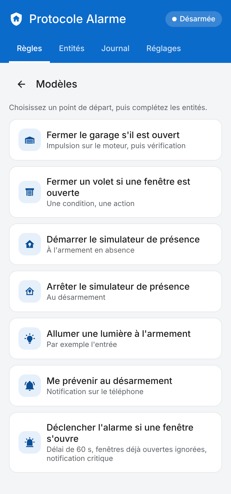 |
| **Étape 1 — Quand ?** 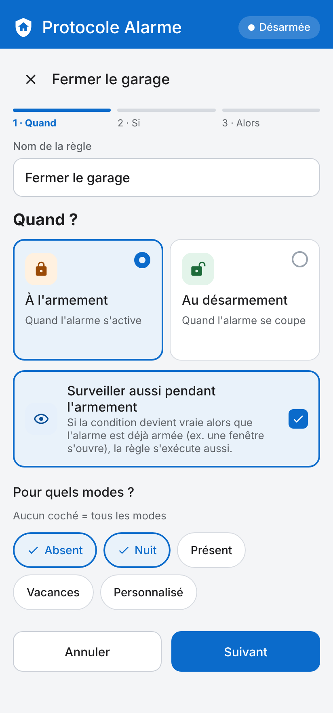 | **Étape 2 — Si…** 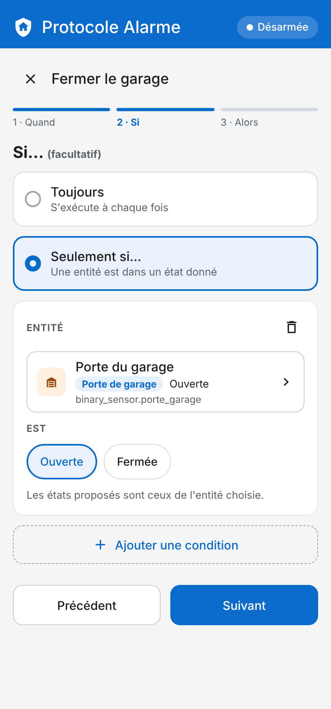 |
| **Étape 3 — Alors…** — impulsion et vérification 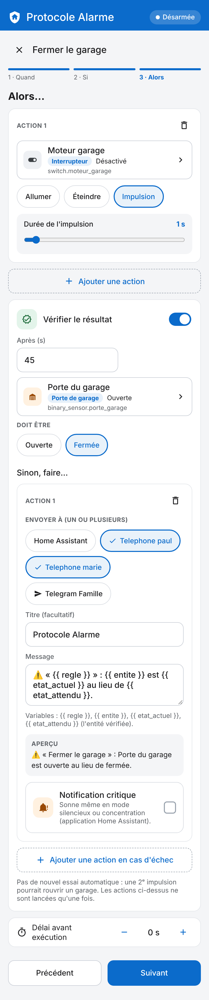 | **Récapitulatif** 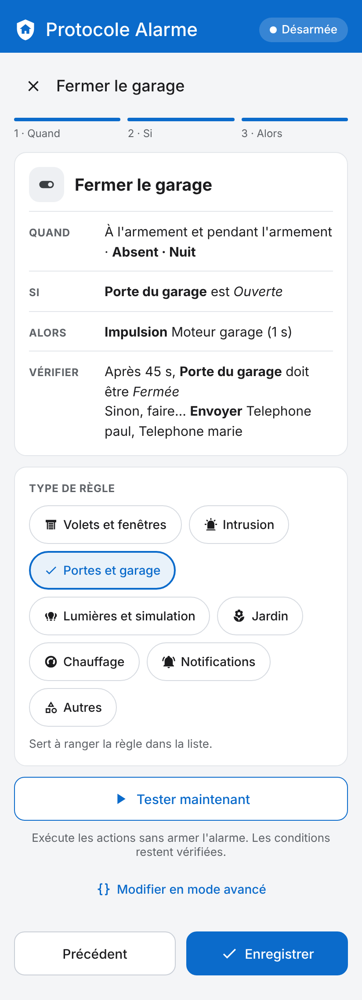 |
| **Choix de l'entité** — type, état, filtres 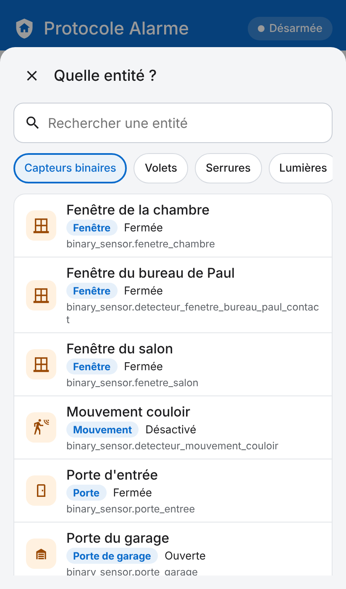 | **Choix de l'action** — Lights Simulator non installé 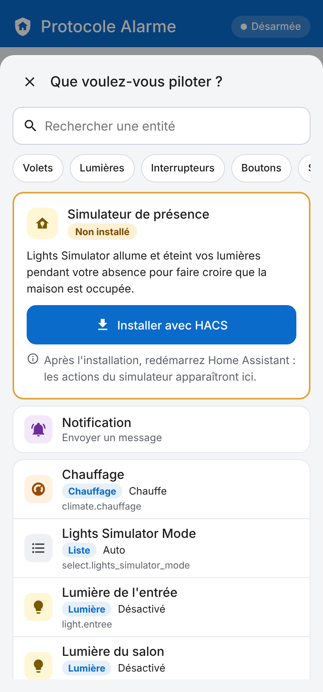 |
| **Mode avancé** — YAML 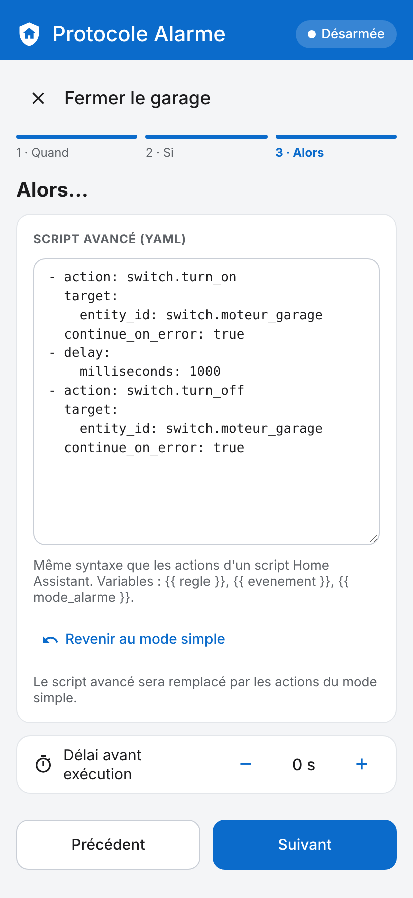 | **Réglages** 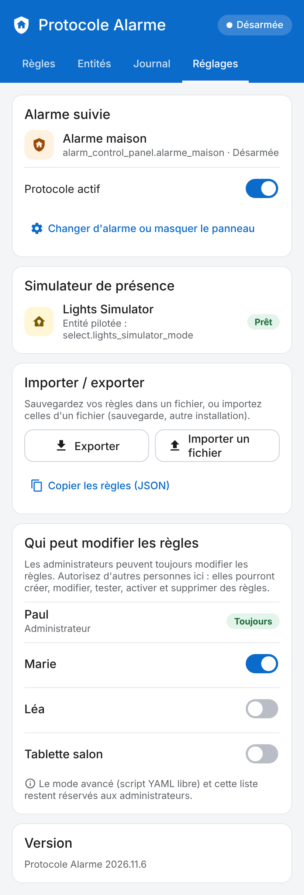 |
| **Journal** 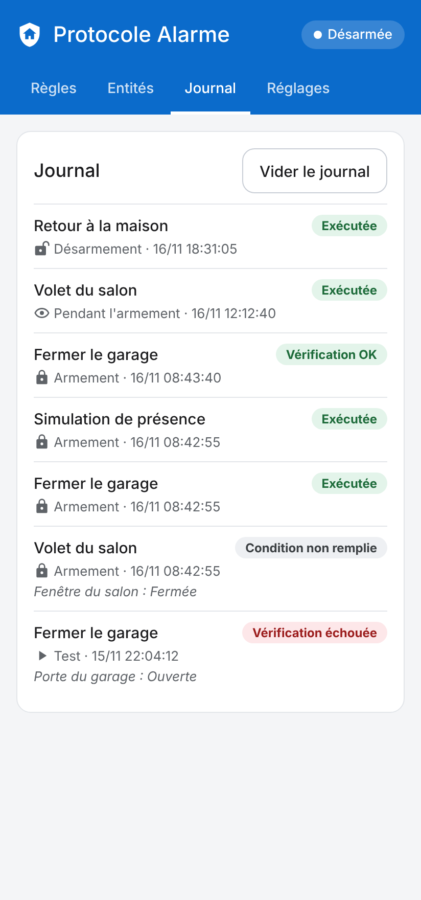 | **Entités** 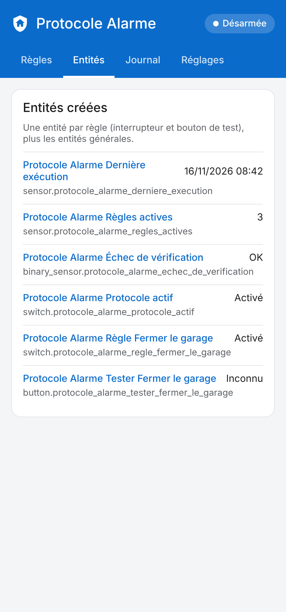 |

*Captures réalisées sur une installation de démonstration : toutes les entités sont fictives.*

### Entités

| Entité | Rôle |
|---|---|
| `switch.protocole_alarme_protocole_actif` | Coupé : plus aucune règle ne s'exécute (le journal le note) |
| `switch.protocole_alarme_regle_<nom>` | Une par règle : règle active ou non |
| `button.protocole_alarme_tester_<nom>` | Une par règle : exécute la règle tout de suite |
| `sensor.protocole_alarme_derniere_execution` | Date de la dernière règle exécutée ; attributs `regle`, `evenement`, `resultat`, `detail` |
| `sensor.protocole_alarme_regles_actives` | Nombre de règles actives ; attributs `armement`, `desarmement` |
| `binary_sensor.protocole_alarme_echec_de_verification` | Problème quand la dernière vérification a échoué |

Les identifiants exacts dépendent de la langue de Home Assistant au moment de l'installation.

### Services

| Service | Rôle |
|---|---|
| `protocole_alarme.exporter_regles` | Renvoie toutes les règles (réponse du service) : sauvegarde, copie vers une autre installation |
| `protocole_alarme.importer_regles` | Ajoute une liste de règles (`regles`), ou remplace toutes les règles (`remplacer: true`). Tout est vérifié avant l'enregistrement : une seule règle invalide et rien n'est modifié |

Ces services sont réservés aux administrateurs (et aux automatisations ou scripts de Home Assistant).

### Sécurité

- Création, modification, duplication, suppression et test des règles depuis le panneau : **administrateurs et personnes autorisées** par un administrateur (vérifié côté serveur). Les autres utilisateurs voient les règles en lecture seule.
- Le **mode avancé** (script YAML libre) et la **liste des personnes autorisées** restent réservés aux administrateurs : un script libre peut appeler n'importe quel service. Une personne autorisée peut renommer, tester ou repasser en mode simple une règle avancée existante, sans modifier son script.
- En mode simple, une règle ne peut appeler que les actions prévues pour chaque type d'entité et les services `notify.*` : pas d'appel de service arbitraire.
- Le mode avancé exécute un script Home Assistant avec les mêmes droits qu'un script créé par un administrateur ; le YAML est lu en mode sûr et vérifié par Home Assistant avant enregistrement.
- Les identifiants d'entité, de règle et de service sont contrôlés, les textes affichés sont échappés, les tailles sont limitées (100 règles, 100 étapes par script avancé, journal de 50 lignes).
- Les actions lancées par un test sont rattachées à l'utilisateur qui l'a lancé, et celles lancées par l'alarme au changement d'état de l'alarme (journal de bord).
- Comme toute entité Home Assistant, l'interrupteur « Protocole actif », les interrupteurs de règle et les boutons « Tester » peuvent être utilisés par tous les utilisateurs et par les assistants vocaux exposés ; limitez leur exposition si nécessaire.

### Limites

- Une seule alarme suivie.
- Les conditions comparent l'état exact d'une entité (pas de seuil numérique) ; pour des cas plus complexes, utilisez le mode avancé.
- Lights Simulator est piloté par son sélecteur « Mode » ; il doit être installé et configuré séparément.

---

## English

Protocole Alarme runs actions when you **arm** or **disarm** your Home Assistant alarm. You choose, entity by entity, what should happen, without writing automations:

- if a window is open, close that room's shutter;
- if the garage door is open, send a pulse to the motor, then check it actually closed;
- turn on a light, set the heating to eco, start the presence simulator;
- when disarmed, stop the simulator, turn on the hallway light, send a notification…

### Features

- **3-step wizard**: *When* (arming or disarming, alarm modes), *If* (optional conditions on entity states), *Then* (actions), followed by a readable summary.
- **Actions with settings by entity type**: covers (open, close, position), lights (turn on with brightness, turn off), switches (on, off, **pulse** with adjustable length), locks, climate (preset, temperature), media, scenes, scripts, automations, selects, valves, buttons and notifications.
- **Result check**: after a delay, checks an entity is in the expected state (e.g. garage closed); otherwise a notification to **one or more people** and a “Check failed” sensor. No automatic retry.
- **Notifications to several recipients**: one action can notify several phones (and/or Home Assistant).
- **Editable failure message**: the default message is shown and can be customized with the `{{ regle }}`, `{{ entite }}`, `{{ etat_actuel }}`, `{{ etat_attendu }}` variables, with a preview; states use Home Assistant's labels.
- **Allowed people**: besides administrators, other users can be allowed to change rules (Settings tab).
- **Readable entity picker**: search, type filters, and for each entity its type (Window, Garage door, Motion…), state and icon.
- **Delay before running** per rule.
- **Cancellation**: disarming stops arming rules still in progress (delay, pulse, check), and the other way round.
- **Home Assistant restart**: never triggers a rule.
- **Presence simulator**: drives [Lights Simulator](https://github.com/akoonet-homeassistant/lights_simulator) (Start, Back to Auto, Stop). If it is not installed, the panel offers to install it through HACS; if it already follows the alarm by itself, a warning flags the double control.
- **Templates** to get started in two clicks (garage, shutter, simulator, light, notification).
- **Advanced mode**: a rule can be edited in YAML (Home Assistant script action syntax), with the `regle`, `evenement` and `mode_alarme` variables.
- **Test button**: runs a rule without arming the alarm (conditions are still checked).
- **Log** of the last 50 runs.
- **Sidebar panel** “Protocole Alarme” readable by everyone; creating, editing and testing are reserved to administrators and the people they allow.
- **French and English interface**, following the user's language.

### Installation

#### Through HACS (custom repository)

1. In HACS, add `https://github.com/akoonet-homeassistant/protocole_alarme` as a custom repository (*Integration* category), or use the button above.
2. Install **Protocole Alarme**, then restart Home Assistant.
3. *Settings → Devices & services → Add integration* → **Protocole Alarme**, then choose the alarm to follow.

#### Manual

Copy `custom_components/protocole_alarme` into the `custom_components` folder of your configuration, restart, then add the integration.

### Usage

Open the **Protocole Alarme** panel in the sidebar.

| Tab | Content |
|---|---|
| Rules | Arming and disarming rules, enable, test, edit, duplicate, delete; add with the wizard or from a template |
| Entities | The created entities with their state |
| Log | Latest runs: rule, moment, result, detail |
| Settings | Followed alarm, protocol enabled or paused, Lights Simulator status, people allowed to change rules (administrators) |

The integration's **Configure** button changes the alarm and shows or hides the panel in the sidebar. When hidden, it stays reachable at `/protocole-alarme`.

**When does a rule run?** On arming, when the alarm goes from *disarmed* or *arming* to an *armed* state (away, night, home, vacation, custom). On disarming, when it goes back to *disarmed* from an armed, pending or triggered state. For disarming rules, the mode filter applies to the mode the alarm was armed in.

### Screenshots

The screenshots above (French interface) show every screen; the interface switches to English automatically for English-speaking users. *All entities are fictional.*

### Entities

| Entity | Role |
|---|---|
| `switch.protocole_alarme_protocol_enabled` | Off: no rule runs any more (noted in the log) |
| `switch.protocole_alarme_rule_<name>` | One per rule: rule enabled or not |
| `button.protocole_alarme_test_<name>` | One per rule: runs the rule right away |
| `sensor.protocole_alarme_last_run` | Date of the last rule run; attributes `regle`, `evenement`, `resultat`, `detail` |
| `sensor.protocole_alarme_active_rules` | Number of active rules; attributes `armement`, `desarmement` |
| `binary_sensor.protocole_alarme_check_failed` | Problem when the last check failed |

Exact entity IDs depend on Home Assistant's language at installation time.

### Services

| Service | Role |
|---|---|
| `protocole_alarme.exporter_regles` | Returns all rules (service response): backup, copy to another installation |
| `protocole_alarme.importer_regles` | Adds a list of rules (`regles`), or replaces all rules (`remplacer: true`). Everything is checked before saving: one invalid rule and nothing is changed |

These services are reserved to administrators (and to Home Assistant automations or scripts).

### Security

- Creating, editing, duplicating, deleting and testing rules from the panel: **administrators and people allowed** by an administrator (checked server-side). Other users see rules read-only.
- **Advanced mode** (free YAML script) and the **list of allowed people** stay reserved to administrators: a free script can call any service. An allowed person can rename, test or switch back to simple mode an existing advanced rule, without changing its script.
- In simple mode, a rule can only call the actions provided for each entity type and `notify.*` services: no arbitrary service call.
- Advanced mode runs a Home Assistant script with the same rights as a script created by an administrator; the YAML is parsed safely and checked by Home Assistant before saving.
- Entity, rule and service IDs are validated, displayed text is escaped, sizes are bounded (100 rules, 100 steps per advanced script, 50 log lines).
- Actions started by a test are linked to the user who started it, and those started by the alarm to the alarm state change (logbook).
- Like any Home Assistant entity, the “Protocol enabled” switch, rule switches and “Test” buttons can be used by every user and by exposed voice assistants; limit their exposure if needed.

### Limitations

- A single alarm is followed.
- Conditions compare an entity's exact state (no numeric threshold); use advanced mode for more complex cases.
- Lights Simulator is driven through its “Mode” select; it must be installed and set up separately.

## Licence / License

MIT
